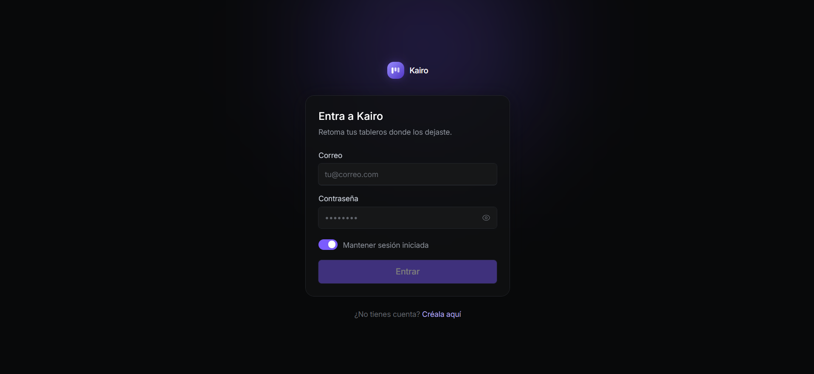
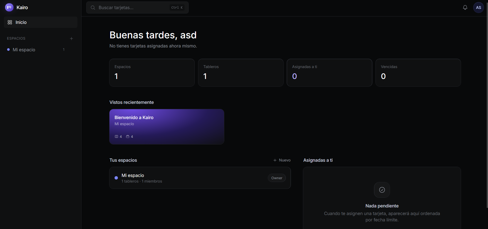
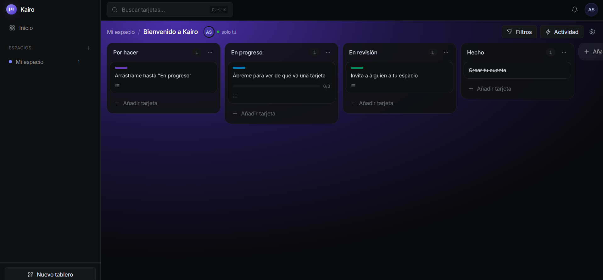

# Kairo

Herramienta de gestión de proyectos estilo Trello/Notion: **workspaces → tableros → listas → tarjetas**,
con colaboración en tiempo real.

- **Backend**: ASP.NET Core 10 Web API + EF Core + SQL Server + Identity/JWT + SignalR.
- **Frontend**: Angular 22 standalone y zoneless + signals, Tailwind v4, Heroicons, Angular CDK
  drag & drop.

## Capturas







---

## Puesta en marcha

Requisitos: .NET 10 SDK, Node 24 y SQL Server Express local (`localhost\SQLEXPRESS`).

En una terminal, la API:

```bash
cd backend && dotnet run
```

En otra, el cliente:

```bash
cd frontend && npm start
```

- API en `http://localhost:5280`, Swagger en `http://localhost:5280/swagger`.
- Cliente en `http://localhost:4200` (ya está en la lista de orígenes CORS de la API).
- En **Development** la base de datos se crea y se migra sola al arrancar: no hace falta
  ejecutar `dotnet ef database update` a mano.

Al registrarte, la cuenta viene con un espacio "Mi espacio" y un tablero de bienvenida con
listas, etiquetas y tarjetas de ejemplo. Para ver el tiempo real, abre el mismo tablero en dos
ventanas (o dos cuentas) y arrastra algo en una.

Configuración relevante:

| Archivo | Qué hay |
|---|---|
| `backend/appsettings.json` | Connection string a `KairoDb`, emisor/audiencia del JWT, orígenes CORS |
| `backend/appsettings.Development.json` | `Jwt:Key` de desarrollo |
| `frontend/src/app/core/api-config.ts` | URL de la API y del hub |

---

## Modelo de datos

```
ApplicationUser ──< WorkspaceMember >── Workspace ──< Board ──< BoardList ──< Card
                                            │                                 ├──< ChecklistItem
                                            │                                 ├──< Comment
                                            ├──< WorkspaceInvitation          ├──< CardAssignee >── ApplicationUser
                                            │                                 └──< CardLabel >── Label ── Board
                                            └── (Board) ──< ActivityLogEntry, BoardVisit

Notification ── ApplicationUser (destinatario)
```

Decisiones que conviene conocer antes de tocar el código:

- **Roles a nivel de workspace** (`Owner` / `Admin` / `Member`), no por tablero. Cualquier miembro
  del workspace ve todos sus tableros. El control de acceso vive en `IWorkspaceAccessService`: el
  join contra `WorkspaceMembers` es lo que decide si un tablero "existe" para un usuario.
- **`Position` es `double`** en listas, tarjetas y checklist: al soltar un elemento entre otros dos
  se guarda el punto medio, así un drag actualiza una sola fila. Cuando el hueco se agota,
  `Ordering.Rebalance` reparte las posiciones de nuevo. Por eso los eventos de movimiento mandan
  las posiciones de todos los hermanos y no solo la del elemento movido.
- **Ids `Guid` v7** (`Guid.CreateVersion7()`): secuenciales, así que se comportan bien como clave
  agrupada en SQL Server, pero no son enumerables desde fuera.
- **Actividad y notificaciones copian sus textos** (título de la tarjeta, nombres de lista y
  tablero). El feed y la campana tienen que seguir leyéndose aunque después renombren o borren
  aquello a lo que apuntan.
- **`CardLabel` no llega en cascada desde `Label`** (SQL Server no admite dos caminos de borrado a
  la misma tabla). Al eliminar etiquetas, listas o tableros, sus filas se limpian explícitamente.
- **Las invitaciones se aceptan dentro de la app**: como el correo queda para fase 2, la invitación
  llega por la campana de notificaciones y solo crea el `WorkspaceMember` al aceptarse.
- **Al registrarse** se crea un workspace "Mi espacio" con un tablero de bienvenida
  (`OnboardingService`), para que la primera pantalla no esté vacía.

---

## API

Todo bajo `/api`, todo con `Authorization: Bearer {token}` salvo `register` y `login`.

### Auth
| Método | Ruta | Qué hace |
|---|---|---|
| POST | `/auth/register` | Crea la cuenta y su workspace inicial. **No** inicia sesión |
| POST | `/auth/login` | Devuelve JWT. `rememberMe` alarga la vigencia a un año |
| GET/PUT | `/auth/me` | Perfil del usuario actual |

### Workspaces
`GET|POST /workspaces` · `GET|PUT|DELETE /workspaces/{id}` · `GET /workspaces/{id}/boards` ·
`GET /workspaces/{id}/members` · `PUT /workspaces/{id}/members/{userId}/role` ·
`DELETE /workspaces/{id}/members/{userId}` (también sirve para salirse) ·
`GET|POST /workspaces/{id}/invitations` · `DELETE /workspaces/{id}/invitations/{invitationId}`

### Invitaciones recibidas
`GET /invitations` · `POST /invitations/{id}/accept` · `POST /invitations/{id}/decline`

### Tableros, listas y tarjetas
| Método | Ruta | Qué hace |
|---|---|---|
| GET | `/boards/{id}` | Tablero completo (listas + tarjetas + etiquetas + miembros) en una llamada |
| GET | `/boards/recent` | Vistos recientemente |
| POST | `/boards` | Crea, opcionalmente con plantilla de columnas y etiquetas |
| PUT | `/boards/{id}` · `/boards/{id}/archive` | Editar / archivar |
| POST | `/boards/{boardId}/lists` | Nueva columna |
| PUT | `/lists/{id}` · `/lists/{id}/move` · `/lists/{id}/archive` | Renombrar / reordenar / archivar |
| POST | `/cards` | Nueva tarjeta |
| GET | `/cards/{id}` | Detalle con checklist y comentarios |
| PUT | `/cards/{id}` · `/cards/{id}/move` · `/cards/{id}/archive` | Editar / mover / archivar |
| POST·DELETE | `/cards/{id}/assignees` · `/cards/{id}/labels/{labelId}` | Responsables y etiquetas |

`move` recibe un **índice** (`newIndex`), no una posición: el cliente razona en índices, que es lo
que le da el CDK al soltar, y el servidor calcula la posición fraccionaria.

### Resto
`GET|POST /boards/{boardId}/labels` · `PUT|DELETE /labels/{id}` ·
`POST /cards/{cardId}/checklist` · `PUT|DELETE /checklist/{id}` ·
`GET|POST /cards/{cardId}/comments` · `PUT|DELETE /comments/{id}` ·
`GET /boards/{boardId}/activity` (paginado) ·
`GET /notifications`, `/notifications/unread-count`, `PUT /notifications/{id}/read`, `PUT /notifications/read-all` ·
`GET /dashboard` · `GET /search/cards?query=&workspaceId=&boardId=&labelId=&assigneeId=&due=`

---

## Tiempo real (SignalR)

Hub en **`/hubs/board`**. El token va por query string (`?access_token=…`) porque el handshake de
WebSockets no admite cabeceras propias; solo se acepta en rutas `/hubs`.

El cliente llama a `JoinBoard(boardId)` / `LeaveBoard(boardId)` — el hub comprueba la membresía
antes de meter la conexión en el grupo. Las notificaciones personales no van por grupo de tablero:
se entregan con `Clients.User(...)`, que resuelve el id desde el claim `sub` vía
`SubjectUserIdProvider`.

Eventos que empuja el servidor (`IBoardClient`):

| Evento | Cuándo |
|---|---|
| `CardCreated` · `CardUpdated` · `CardMoved` · `CardArchived` | Alta, edición, arrastre y archivado de tarjetas |
| `ListCreated` · `ListRenamed` · `ListMoved` · `ListArchived` | Lo mismo para columnas |
| `BoardInfoChanged` · `BoardLabelsChanged` | Nombre/fondo del tablero y paleta de etiquetas |
| `CommentAdded` · `CommentUpdated` · `CommentDeleted` | Comentarios |
| `ChecklistChanged` | Checklist + contadores de la miniatura |
| `ActivityAdded` | Nueva línea del feed de actividad |
| `PresenceChanged` | Quién tiene el tablero abierto ahora mismo |
| `NotificationReceived` | Va al usuario, no al tablero |

---

## Frontend

Angular 22 **standalone y zoneless**: no hay `zone.js`: el estado son signals y la detección de
cambios se dispara al escribirlos. Es lo que hace que los eventos de SignalR se apliquen sin
ningún `NgZone.run` de por medio.

```
src/app/
  core/        modelos (espejo de los DTOs), servicios HTTP, auth, SignalR, utilidades
  layout/      shell con barra lateral, buscador global, campana de notificaciones
  pages/       landing · login/registro · dashboard · espacio · configuración · tablero
  shared/      componentes, directivas de animación, iconos y sistema de diseño
```

### Sistema de diseño

Punto de partida: el `DESIGN.md` de **Linear** en styles.refero.design. De ahí salen la escala de
superficies casi negras (`void → carbon → obsidian`), los bordes *hairline* de 0.5px en vez de
sombras, los pesos tipográficos por debajo de 600 y la escalera de espaciado 8/12/24/96. Todo
vive en `src/styles.css` como tokens `@theme` de Tailwind v4.

Lo que **no** se copió es el acento: Linear usa un lima ácido y aquí es un iris eléctrico
(`#7b5cff`). El motivo es funcional: en un gestor de tareas el ámbar ya significa "vence pronto"
y el rojo "vencida", así que el color de acción tenía que quedarse fuera de esa conversación.

Los tokens de color que guarda el backend (`violet`, `aurora`, `indigo`…) se traducen a clases en
`shared/design/palette.ts`, con las cadenas escritas enteras porque Tailwind rastrea literales:
`bg-${color}-500` no compilaría a nada.

### Animación

- **Hero de la landing**: aurora de fondo, maqueta de tablero que se inclina siguiendo al puntero
  (`appTilt`) y una tarjeta "agarrada" por otra persona con su cursor y su nombre, que es la
  promesa del producto enseñada en vez de contada.
- **Tarjetas de producto**: foco que sigue al cursor (`appSpotlight`). La directiva solo escribe
  dos variables CSS y el degradado hace el resto, así que moverse por la tarjeta no cuesta un
  ciclo de Angular.
- **Aparición al hacer scroll** (`appReveal`) con IntersectionObserver.
- **Micro-interacciones**: casilla cuyo tick se traza con `stroke-dasharray` al marcar, switch,
  anillo de carga hecho con un degradado cónico recortado por `mask`.
- `prefers-reduced-motion` se respeta de verdad: la regla global neutraliza duraciones y las
  directivas comprueban `matchMedia` antes de tocar nada. No se oculta contenido, solo se queda
  quieto.

### Iconos

Solo Heroicons. Los paths se extraen del paquete npm `heroicons` (24/outline) a
`shared/icons/heroicons.ts` con un generador, y el componente `<app-icon>` los pinta heredando
`currentColor`. Sin dependencias en runtime y sin paths escritos a mano.

### Drag & drop

`@angular/cdk/drag-drop`. Las columnas son una zona horizontal; las tarjetas, una zona por
columna conectadas entre sí **por id** en vez de con `cdkDropListGroup` — si no, la lista
horizontal de columnas entraría en el mismo grupo y se podrían soltar tarjetas sobre ella.

El movimiento se pinta antes de que conteste el servidor y se confirma después. Al mandar un
**índice** en vez de una posición, el cliente no replica la aritmética del indexado fraccionario.
Con filtros activos el arrastre se desactiva: los huecos que ve el usuario no son los de la lista
completa, así que soltar mentiría sobre dónde cae la tarjeta.

### Estado del tablero

`BoardStore` se provee a nivel del componente `Board`, no en root: al salir del tablero se
destruye con él y deja de escuchar eventos. Su regla es que todo cambio se aplica **de forma
idempotente por id**, porque un mismo movimiento llega dos veces —por la respuesta HTTP y por el
eco de SignalR— y el resultado tiene que ser el mismo en cualquier orden.

---

## Fuera de alcance (fase 2)

Adjuntar archivos, notificaciones por correo, vista de calendario y menciones con `@`.

La app es **solo tema oscuro**, por coherencia con la referencia de diseño. Un modo claro a
medias se vería peor que no tenerlo.
